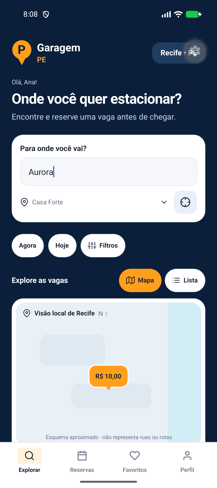
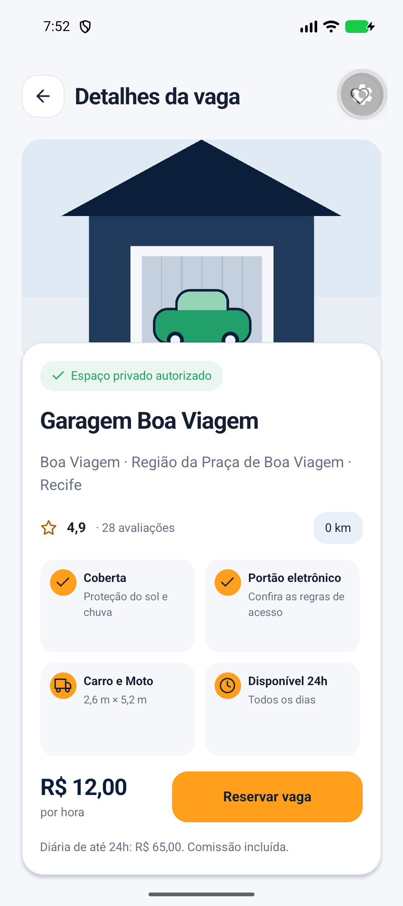
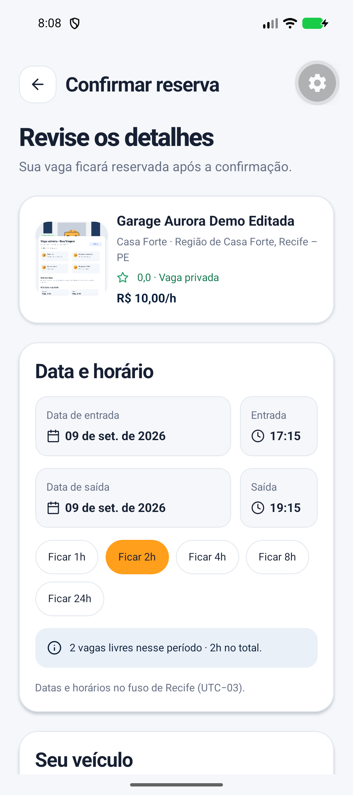
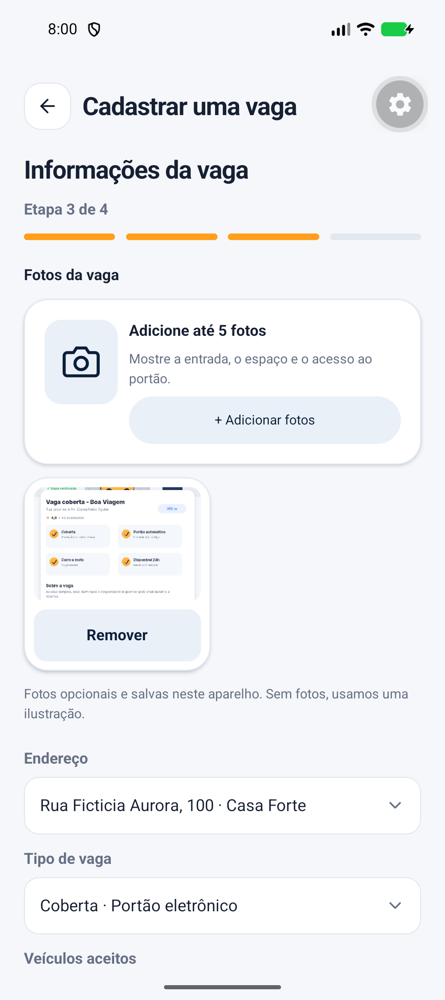
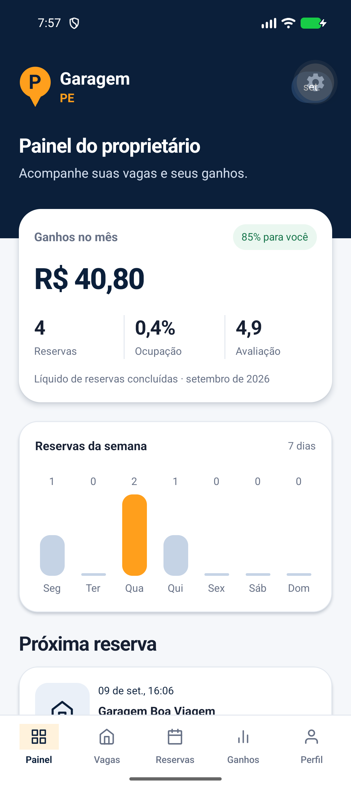

# Garagem PE — versão navegável

Entrega organizada em **16/10/2026**.

**Repositório público:** https://github.com/PSX14/garagem-pe

Aplicativo acadêmico em React Native, Expo e TypeScript. Permite pesquisar e reservar vagas como motorista e cadastrar espaços, gerenciar reservas e consultar ganhos simulados como proprietário. Os dados são persistidos localmente. Não há autenticação, pagamento ou serviço de reservas reais.

## Itens da entrega

| Item solicitado | Onde conferir |
| --- | --- |
| Versão navegável e principais telas | Código do aplicativo no repositório; execução pelo Expo Go Android |
| Formulários e validações básicas | Reserva, veículos, perfil e cadastro de vaga em quatro etapas |
| GitHub atualizado e README | README principal com instalação, funcionalidades, regras e limitações |
| 3–5 capturas de tela | Cinco capturas reais abaixo e arquivos PNG nesta pasta |

## Executar

Na pasta que contém `package.json`, usando o PowerShell:

```powershell
npm.cmd ci
npm.cmd start
```

Use Node 24.3 ou superior na linha 24, e Expo Go Android compatível com SDK 57. Conecte celular e computador à mesma rede e abra o QR Code pelo Expo Go. Mantenha o terminal aberto. Consulte o [README completo](../../README.md) para instruções adicionais.

## Roteiro de avaliação

1. Entre no modo demonstração. Em **Explorar**, pesquise uma vaga, alterne mapa/lista, aplique filtros e abra os detalhes.
2. Toque em **Reservar vaga**, escolha um período futuro disponível e um veículo. Confirme e confira o código e a reserva na aba **Reservas**.
3. Em **Perfil**, alterne para proprietário. Abra o cadastro de vaga e percorra as quatro etapas. Preencha os campos, adicione uma foto local e declare a autorização para disponibilizar o espaço.
4. Publique a vaga, consulte-a na lista, edite e pause/reative o anúncio. Abra o painel e as reservas do proprietário.
5. Feche e reabra o projeto no mesmo Expo Go para conferir os dados salvos. Não limpe os dados do aplicativo durante esse teste.

Para observar as validações, tente avançar com campos obrigatórios vazios, uma saída anterior à entrada ou um cadastro sem a declaração de autorização. Corrija os campos e repita. Preços, duração, disponibilidade, capacidade e conflitos de reservas também são validados.

## Cinco capturas reais

Capturas do aplicativo executado no **Expo Go para Android em 09/09/2026**, selecionadas para esta entrega. Não são mockups. Os dados e valores são demonstrativos; o ícone flutuante de engrenagem pertence ao Expo Go. Algumas fotos de teste foram escolhidas da galeria usando imagens das referências.

### 1. Início — pesquisa e exploração de vagas

Mapa demonstrativo local com preços clicáveis, pesquisa, filtros e navegação principal. A alternativa local mantém a busca utilizável quando o mapa online não carrega.



### 2. Detalhes da vaga

Características, avaliação, preço e ação para iniciar a reserva. O endereço completo fica disponível após a confirmação.



### 3. Formulário de reserva

Escolha de entrada, saída e veículo, com cálculo e validação do período disponível. A data exibida corresponde à captura histórica; em uma nova avaliação, selecione datas futuras.



### 4. Cadastro de vaga

Etapa do formulário do proprietário com foto local, endereço e características da vaga. O cadastro completo tem quatro etapas.



### 5. Painel do proprietário

Resumo de ganhos simulados, reservas, ocupação, avaliação e gráfico semanal.



## Verificação e limites

Os resultados da conferência desta entrega estão em [VERIFICACOES.md](VERIFICACOES.md). A execução Android, os fluxos completos, a persistência após reinício e a comparação visual realizados em setembro estão registrados no [relatório de validação](../RELATORIO-VALIDACAO.md) e na [revisão visual](../REVISAO-VISUAL.md).

As capturas não representam uma nova execução Android em outubro. O mapa online apresentou falha de autorização no Expo Go durante os testes anteriores; mapa local e lista permitem continuar os fluxos. O bundle Android exportado é diferente de um APK instalável; a compilação e instalação de APK ainda não foram realizadas.
